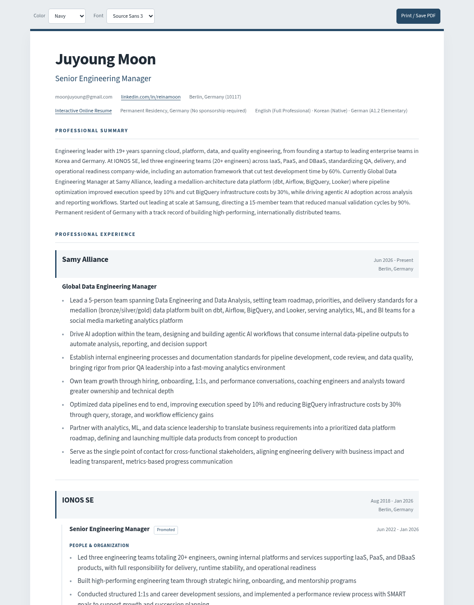

  
  # Juyoung Moon's Interactive Resume
  
  

    <em>A responsive, printer-friendly, and interactive resume built from scratch with HTML & CSS.</em>
  

  
  

    
    
    
    
  

 

 

  
  
  
  

 

## ✨ About This Project
> I believe a resume should be more than just a document. It should be a reflection of one's craftsmanship and attention to detail. That's why I chose to build my own resume using web technologies.
> This project demonstrates not only my technical skills in front-end development but also my commitment to creating a high-quality, user-friendly experience.

 

## 🚀 Key Features
*   🎨 **Built from Scratch:** Coded entirely by hand using pure HTML5 and modern CSS3.
*   📱 **Fully Responsive Design:** Optimized for a seamless experience on desktops, tablets, and mobile devices.
*   📄 **Printer-Friendly:** A custom print stylesheet ensures the resume looks clean and professional when printed or saved as a PDF.
*   🔗 **Interactive Elements:** Choose from two color themes and four fonts, then use Print / Save PDF to save the current view as a PDF. Includes clickable email and LinkedIn links.

 

## 📜 License
This project is licensed under the **MIT License**. See the `LICENSE` file for details.

 

 

<strong>🇰🇷 한국어 버전 보기 (Click to expand)</strong>

 
  

  
  # 주영 문(Juyoung Moon)의 인터랙티브 이력서
  
  

    <em>HTML과 CSS를 사용하여 처음부터 직접 제작한 반응형, 인쇄 최적화, 인터랙티브 이력서입니다.</em>
  

## ✨ 이 프로젝트에 대하여
> 저는 이력서가 단순한 문서를 넘어, 개발자의 장인정신(craftsmanship)과 디테일에 대한 열정을 보여주는 결과물이어야 한다고 믿습니다. 이러한 신념을 보여드리고자 웹 기술을 이용해 저의 이력서를 직접 구현했습니다.
> 이 프로젝트는 저의 프론트엔드 개발 역량뿐만 아니라, 높은 품질과 사용자 친화적인 경험을 만들고자 하는 저의 의지를 보여줍니다.

## 🚀 주요 특징
*   🎨 **순수 코드로 직접 구현:** 별도의 프레임워크나 템플릿 없이, 오직 HTML5와 최신 CSS3를 사용하여 직접 코드를 작성했습니다.
*   📱 **완벽한 반응형 디자인:** 데스크톱, 태블릿, 모바일 등 어떤 기기에서도 최적화된 화면을 경험할 수 있도록 설계했습니다.
*   📄 **인쇄용 스타일 최적화:** 별도의 인쇄용 스타일시트를 적용하여, 이력서를 인쇄하거나 PDF로 저장할 때도 깔끔하고 전문적인 결과물이 나오도록 했습니다.
*   🔗 **인터랙티브 요소:** 두 가지 컬러 테마와 네 가지 폰트 중 원하는 조합을 고른 다음 Print / Save PDF로 현재 화면을 그대로 PDF로 저장할 수 있습니다. 이메일과 링크드인 링크도 클릭할 수 있습니다.

## 📜 라이선스
이 프로젝트는 **MIT 라이선스**를 따릅니다. 자세한 내용은 `LICENSE` 파일을 참고해 주세요.
  

